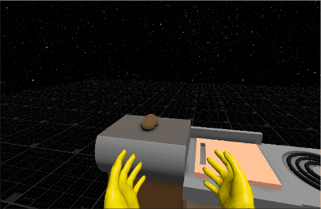
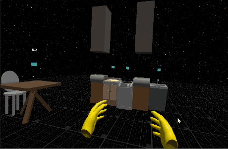
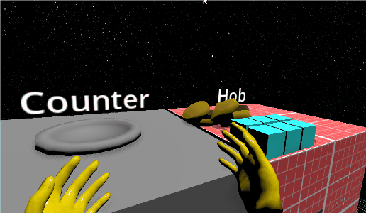

# 🍳 VRyHungry

### A chaotic multiplayer VR cooking experience
Heavily inspired by PlateUp! We wanted to make a hectic cooking and resturant game where it's all about chaos management.  
The goal is to have some friends join you in building a resutrant, moving things around and buying more stations from the store. Then completing days where customers come in to order. If any run out of patience ordering or waiting for food you lose. After each day you get to modify the resturant again.

#### Current state
`We are doing play tests with friends after a lot of networking refactoring to determine what is fun and if any designed systems needs pivoting`  

---

## About the project
- **Virtual Reality** – VR interaction using Godot and OpenXR.
- **Multiplayer** – Headless server with all clients network architecture for cooperative games with 2-6 players. 
- **Kitchen Stations** – Cooking Stations and interactive food and plates.
- **Food & Ingredients** – Items, containers and tables with customers that consume the food they ordered.
- **Recipes** – Data-driven recipe definitions in YAML.
- **Player Systems** – Player functionality and interaction.
- **Environment** – Restaurant scenes, props and visual assets.
- **User Interface** – In-game UI and supporting systems.

## Technology

- [**Godot Engine**](https://godotengine.org/) – Game engine.
- [**OpenXR**](https://www.khronos.org/openxr/) – VR platform integration.
- **Godot Multiplayer API** – Networking infrastructure.
- **Git LFS** – Version control for large textures and binary assets.


## Documentation
Additional project documentation can be found in:
[`documentation/`](documentation/)

[`documentation/Stations.md`](documentation/Stations.md)
Talks about what Stations exist and how they inherit from the abstract scrips.

[`documentation/RecipeManager.md`](documentation/RecipeManager.md)
Talks about how the recipes are read from YAML into the game and how Stations use it to determine player interactions.

This directory contains supporting material for the project's development and technical systems.

## Media
#### Chopping and Cooking

#### Buying and moving Stations from the Shop

#### Plates that store food and get dirty



### Clone the repository

```bash
git lfs install
git clone https://github.com/JonShard/VRyHungry.git
cd VRyHungry
git lfs install
git lfs pull
```
Git LFS is required to retrieve large project assets, including high-resolution environment textures.
Large textures and other binary resources should be tracked through the repository's `.gitattributes` configuration.

### Open the project
1. Start Godot Engine.
2. Select **Import**.
3. Navigate to the cloned repository.
4. Select `project.godot`.
5. Import and open the project.

Configure your OpenXR runtime and VR device before testing VR functionality.

##  Development
VRyHungry is an evolving project. Gameplay systems, interactions, networking and environments are being developed and refined.

The project is structured to keep gameplay components modular and reusable, making it easier to extend kitchen equipment, introduce new ingredients and build additional gameplay systems.