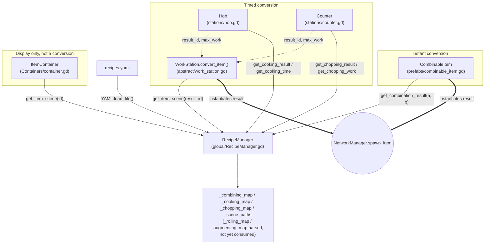

# Recipes

## FoodItem

Every ingredient, meal, and side in the game is a `FoodItem` node (`prefabs/food_item.gd`), a sibling component on the pickable item's scene. It's just three exported fields:

- `id: String` — the recipe key this item is looked up by in `recipes.yaml` (e.g. `"raw_burger"`).
- `type: Type` — `MEAL`, `SIDE`, `INGREDIENT`, or `NONE`. Used for things like which plate slot an item lands in.
- `sell_value: int` — money paid out when the item is sold/consumed.

`id` is the link between a spawned scene and its entry in `recipes.yaml` — every process below keys off it.

## `recipes.yaml`

`RecipeManager` loads a single file, `res://recipes.yaml`, with one top-level section per process plus an `items` section mapping each `id` to its scene:

```yaml
items:
  raw_burger:
    scene: res://items/burger.tscn
  cooked_burger:
    scene: res://items/cooked_burger.tscn

combining:            # instant, two items -> one
  hamburger:
    - [cooked_burger, burger_buns]

cooking: # timed, one item -> one (a station's work meter)
  cooked_burger:
    ingredient: raw_burger
    time: 4

chopping:              # timed, one item -> one
  chopped_potato:
    ingredient: potato
    work: 30

rolling:                # parsed, no station consumes it yet
  pie_base:
    ingredient: dough
    work: 80

augmenting:              # parsed, no station consumes it yet
  cooked_burger:
    has_tomato: sliced_tomato
```

`cooking` entries may also be a list, so multiple ingredients can produce the same result (see `charcoal` in the real file, which can be made by overcooking three different things).

## RecipeManager

`RecipeManager` (`global/RecipeManager.gd`) is a static class — no instance needed. On first use it lazily parses `recipes.yaml` (via the `YAML` addon) into five internal maps (`_combining_map`, `_cooking_map`, `_chopping_map`, `_rolling_map`, `_augmenting_map`) plus `_scene_paths`, and never re-parses after (`_loaded` guard).

It doesn't hand out those raw maps. Instead it exposes narrow getters that the rest of the game calls:

| Function | Returns |
|---|---|
| `get_combination_result(a, b)` | `PackedScene` for combining two ids (order-independent) |
| `get_cooking_result(ingredient)` | result id, or `""` if not cookable |
| `get_cooking_time(ingredient)` | seconds of work needed |
| `get_chopping_result(ingredient)` | result id, or `""` if not choppable |
| `get_chopping_work(ingredient)` | work needed |
| `get_item_scene(id)` | `PackedScene` for any item id |
| `print_all_recipes()` | debug dump of every loaded recipe, called once from `main.gd` at startup |

`rolling` and `augmenting` are parsed and included in `print_all_recipes()`, but currently have no matching getters or station — they're not wired into a conversion process yet.

## Conversion processes

Two different mechanisms turn one `FoodItem` into another today:

**Combining** — instant, no station involved. `CombinableItem` (`prefabs/combinable_item.gd`) sits on every pickable item; while the item is snapped into a zone, its trigger area watches for another `FoodItem` entering. On contact it asks `RecipeManager.get_combination_result(a, b)` — if a recipe exists, it despawns both ingredients and spawns the result in their place.

**Cooking / chopping** — timed, driven by `WorkStation`'s shared work meter (`current_work` / `max_work` / `result_id`, see [Stations.md](Stations.md)). When a `Hob` or `Counter` picks up a `FoodItem`, it asks `RecipeManager` whether that ingredient has a recipe for its process (`get_cooking_result`/`get_chopping_result`) and, if so, how much work it needs (`get_cooking_time`/`get_chopping_work`), then starts accumulating work — a `Hob` ticks it every frame, a `Counter` adds it per knife swipe. Once `current_work` reaches `max_work`, `WorkStation.convert_item()` calls `RecipeManager.get_item_scene(result_id)`, despawns the original item, and spawns the result in the same snap zone.

Separately, `ItemContainer` (`Containers/container.gd`) calls `get_item_scene(id)` too, but only to instantiate the correct visual mesh for each id in a plate's synced contents list — that's a display lookup, not a conversion.

## Diagram



Solid arrows are calls into `RecipeManager`; dotted arrows are `Hob`/`Counter` handing their recipe off to `WorkStation`'s shared work meter; thick arrows are the actual item conversion. `CombinableItem` and `WorkStation` are grouped in adjacent lanes so both paths to `NetworkManager.spawn_item` stay short; `ItemContainer` sits in its own lane since it never spawns anything.
