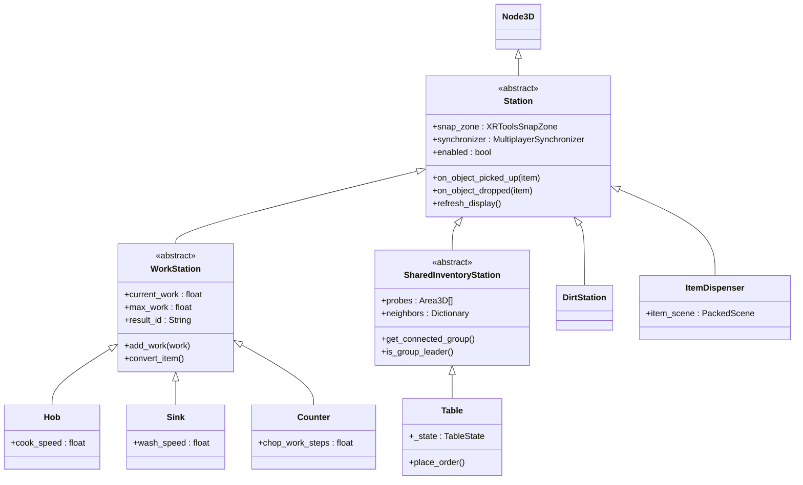

# Stations

## Overview

A "station" is any interactable kitchen fixture a player works at: `Counter`, `Hob`, `Sink`, `Table`, `DirtStation`, and the item dispensers. They share networking, sound, and snap-zone plumbing through a common script base, and share their node layout through a common base scene.

Two independent inheritance mechanisms combine to build a concrete station, e.g. `Table`:

- **Scene inheritance** — `table.tscn` is a Godot "inherited scene" of `abstract/station.tscn`, so it gets the same child nodes (snap zone, synchronizer, audio players, progress bar) for free.
- **Script inheritance** — `table.gd` (attached as a script override on that inherited scene) extends `SharedInventoryStation`, which extends `Station`.

These two axes are independent: which base scene a `.tscn` inherits from is unrelated to which class its attached script extends.

## Scene inheritance

`abstract/station.tscn` is the base scene every station scene inherits from:

```
Station (Node3D)
├─ StationMovement      (drag-to-move handle, res://stations/StationMovement.tscn)
├─ MultiplayerSynchronizer
├─ AudioStreamPlayer3DNotification
├─ AudioStreamPlayer3DAmbient
├─ ProgressBar3D
└─ SnapZone
```

Each concrete station scene inherits this scene and overrides the root node's `script` property to attach its own class:

| Scene | Script attached |
|---|---|
| `Counter.tscn` | `stations/counter.gd` (`Counter`) |
| `Hob.tscn` | `stations/hob.gd` (`Hob`) |
| `sink.tscn` | `stations/sink.gd` (`Sink`) |
| `table.tscn` | `stations/table.gd` (`Table`) |
| `dirt_station.tscn` | `stations/dirt_station.gd` (`DirtStation`) |
| `BurgerBunsDispenser.tscn`, `cube_side_dispense.tscn`, `plate_dispenser.tscn`, `potato_dispenser.tscn`, `raw_burger_dispenser.tscn` | `stations/item_dispenser.gd` (`ItemDispenser`) |

`StationMovement` (`stations/station_movement.gd`) is a sibling node composed into the base scene, not a station subclass — it's what lets players pick the whole station up and move it in build mode.

## Script (class) inheritance



| Class | File | Role |
|---|---|---|
| `Station` | `abstract/station.gd` | Base for every station. Owns the snap zone, sets up the `MultiplayerSynchronizer`'s replication config, propagates pickup/drop events to clients over RPC, and exposes virtual hooks (`on_object_picked_up`, `on_object_dropped`, `on_food_item_picked_up`, `on_food_item_dropped`, `refresh_display`). |
| `WorkStation` | `abstract/work_station.gd` | Base for stations that convert a held `FoodItem` over time via a synced work meter (`current_work`/`max_work`/`result_id`). `add_work()` routes through the server via RPC, and `convert_item()` swaps the held item for the recipe result on completion. |
| `Hob` | `stations/hob.gd` | Cooks food using `RecipeManager` cooking recipes; plays a cook animation while active. |
| `Sink` | `stations/sink.gd` | Washes a dirty `PlateController` over time; drives water/bubble effect nodes. |
| `Counter` | `stations/counter.gd` | Chops food when a knife gesture area detects a fast-enough swipe. |
| `SharedInventoryStation` | `abstract/shared_inventory_station.gd` | Base for stations that need to know about same-kind neighbors. Resolves `probe_paths` into neighbor `Area3D`s, builds a connected-group graph (cycle-safe, for belt/table loops), and computes a deterministic group leader. |
| `Table` | `stations/table.gd` | The only concrete `SharedInventoryStation`. Runs the customer-order finite state machine (`EMPTY → THINKING → ORDERING → WAITING_PRIMARY → WAITING_FRIEND → EATING`); the connected group's leader orchestrates state, followers mirror it. |
| `DirtStation` | `stations/dirt_station.gd` | Marks a dropped plate as dirty. Extends `Station` directly (no work meter). |
| `ItemDispenser` | `stations/item_dispenser.gd` | Server keeps a fresh instance of `item_scene` spawned into its snap zone whenever it's empty. Extends `Station` directly. |

## Networking pattern

Every station follows the same client/server split, established in `Station`:

- The server (`NetworkManager.owns_world()`) is authoritative for state changes.
- A client calls a public method (e.g. `add_work`, `place_order`); if it isn't the server, that method forwards the call via `*_id.rpc_id(1)` and returns.
- The server applies the change locally, then RPCs the result back out to clients (e.g. `_clients_on_object_picked_up_handler`, `_everyone_on_work_complete`).
- Frequently-changing fields (`current_work`, `result_id`, table `_state`, etc.) are also registered on `sync_config` in `_enter_tree()` for straight property replication.

## Notes

- `stations/station.gd` (`extends "res://stations/hob.gd"`, no `class_name`) is not attached to any scene and isn't part of this hierarchy — it looks like leftover scaffolding.
